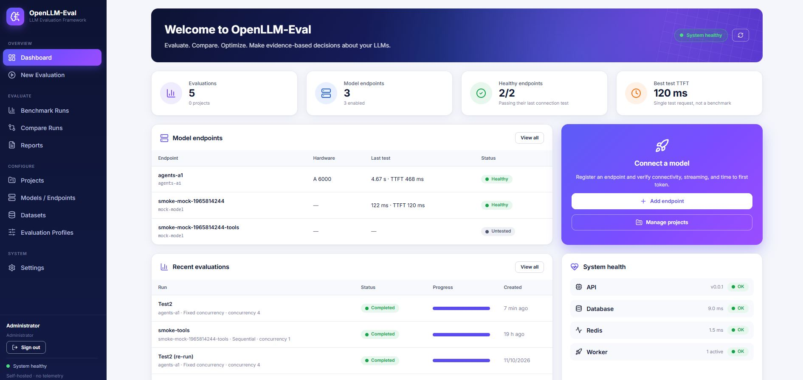

<p align="center">
  <picture>
    <source media="(prefers-color-scheme: dark)" srcset="docs/assets/logo-dark.svg">
    
  </picture>
</p>

<h3 align="center">Self-hosted benchmarking and evaluation for LLM inference endpoints</h3>

<p align="center">
  Measure latency and throughput <i>and</i> whether the answers are right, on your own hardware.
</p>

<p align="center">
  <a href="https://github.com/mkamranr/openllm-eval/actions/workflows/ci.yml"></a>
  <a href="LICENSE"></a>
  
  
  
</p>

<p align="center">
  <a href="#quick-start">Quick start</a> ·
  <a href="#features">Features</a> ·
  <a href="#command-line">CLI</a> ·
  <a href="#architecture">Architecture</a> ·
  <a href="#documentation">Docs</a> ·
  <a href="CHANGELOG.md">Changelog</a>
</p>

<p align="center">
  
</p>

---

## Overview

OpenLLM-Eval connects to any **OpenAI-compatible endpoint** (vLLM, llama.cpp, Ollama, TGI,
LM Studio, or a hosted API) and runs reproducible load tests and quality evaluations against
versioned datasets.

- **Traceable** — every request is stored, so each number links back to the requests that produced it.
- **Reproducible** — every run keeps an immutable, secret-free snapshot of its configuration.
- **Honest** — missing measurements are reported as *unavailable* with a reason, never as `0`.
- **Private** — runs entirely on your infrastructure: no telemetry, no CDN, no model downloads.

## Features

### Evaluation

| Suite | What it measures |
|---|---|
| **Performance** | TTFT, latency percentiles (p50–p99), inter-token latency, tokens/s, throughput, and error rates. Smoke, sequential, fixed-concurrency, ramp, and sustained load profiles; warm-up requests are excluded and retries tracked. |
| **Answer quality** | Exact, normalized, contains-reference, and token-F1 matching; refusal heuristic for safety cases; optional embedding similarity. |
| **Structured output** | JSON validity, JSON Schema (Draft 2020-12) conformance with violation paths, and expected-field match. |
| **RAG & hallucination** | Faithfulness, citation precision/recall, context relevance, precision/recall, and abstention on unanswerable questions. Each claim is classified as supported, unsupported, contradicted, or unverifiable, with evidence and source. Lexical by default; LLM judge optional. |
| **Tool calling** | Tool selection scored separately from argument correctness; call precision/recall; invented-tool and malformed-argument rates. Tool results are **simulated** from dataset fixtures by default, or executed in an opt-in **sandboxed integration mode**. |

### Platform

| Area | What you get |
|---|---|
| **Endpoints** | Streaming and non-streaming adapter, connection tests, model discovery, and secret references so API keys never reach the database. An outbound network policy guards against SSRF. |
| **Datasets** | JSONL/CSV import with line-numbered validation, immutable versions with SHA-256 hashes, 8 case types (chat, instruction, Q&A, structured output, tool call, RAG, long context, safety), and bundled samples. |
| **Runs** | Background worker with a database-backed queue and leases, live progress over SSE, cancel, and retry-failed. |
| **Reports & comparison** | Offline HTML report (charts, metrics, failures, configuration, methodology, reproduction steps); JSON, CSV, and Markdown exports; side-by-side comparison that flags configuration differences, labels comparability, and lists per-case regressions. One-click re-run. |
| **Profiles** | Reusable evaluation settings, shared across the UI, API, and CLI. |
| **Access control** | Local accounts or Active Directory (LDAP/LDAPS, optional Windows SSO via Kerberos), viewer / editor / admin roles from AD group mappings, API tokens, sign-in lockout, and an audit log. |
| **Interfaces** | Web UI (dashboard, New Evaluation wizard, run explorer, reports, comparison), REST API with OpenAPI, and the `openllm-eval` CLI with YAML run configs. |

## Quick start

> **Requirements:** Docker with Compose v2.

```bash
cp .env.example .env      # set POSTGRES_PASSWORD (and BIND_ADDRESS=0.0.0.0 for remote access)
bash scripts/deploy.sh    # builds, migrates, starts, and runs the smoke test
```

The first deploy prints the `admin` password; you choose a new one at first sign-in.

| Service | URL |
|---|---|
| Web UI | http://localhost:3000 |
| API readiness | http://localhost:8000/api/v1/health/ready |
| OpenAPI schema | http://localhost:8000/api/openapi.json |

### Try it without a GPU

A bundled mock model server lets you explore the whole workflow without real hardware:

```bash
echo "ENDPOINT_ALLOWED_HOSTS=mock-llm" >> .env
bash scripts/deploy.sh --mock
```

1. Go to **Models / Endpoints → Add endpoint**, use base URL `http://mock-llm:9000/v1` and model `mock-model`, then click **Test**.
2. Open **New Evaluation** and pick the endpoint.
3. Select the *Performance* and *Answer quality* suites.
4. Add the *Sample: general Q&A* dataset and start the run.

### Upgrading

Unpack the new release into any folder, copy over `.env` (plus `secrets.env` and
`tools/tools.yaml` if you use them), and run `bash scripts/deploy.sh`. The script stops the
previous install's containers, keeps the data volumes, and applies database migrations.

## Command line

Describe a run in YAML:

```yaml
# bench.yaml
name: vllm-baseline
endpoints: [local-vllm]
dataset:
  name: "Sample: general Q&A"
evaluation:
  suites: [performance, answer_quality]
generation:
  temperature: 0
  max_tokens: 256
load:
  profile: fixed_concurrency
  requests: 100
  concurrency: 8
  warmup_requests: 5
```

Then run it:

```bash
openllm-eval auth login -u alice                     # once: stores an API token
openllm-eval run create --config bench.yaml --wait
openllm-eval run results <run-id>
```

See the [CLI reference](docs/reference/cli.md) for every command.

## Architecture

```text
browser ──► frontend (nginx) ──/api──► api (FastAPI) ──► PostgreSQL
                                          │          └─► Redis (wake-up signal, heartbeats)
                                       worker ──► model endpoints (adapters + network policy)
```

| Layer | Stack |
|---|---|
| Backend | Python 3.12 modular monolith — FastAPI, async SQLAlchemy 2, Alembic — deployed as an API and a worker process |
| Frontend | React 18 + TypeScript, built with Vite and served by nginx |
| Storage | PostgreSQL for all data; Redis for wake-up signals and heartbeats |

Read the [architecture overview](docs/architecture/overview.md) for details.

## Documentation

| Guide | Description |
|---|---|
| [Getting started](docs/user-guide/getting-started.md) | Endpoints, datasets, runs, quality evaluation, and profiles, step by step |
| [Dataset format](docs/user-guide/datasets.md) | Case types, fields, and JSONL/CSV examples |
| [Authentication](docs/user-guide/authentication.md) | Users, roles, Active Directory, and Windows single sign-on |
| [Tool sandbox](docs/user-guide/tool-sandbox.md) | Executing tool calls in integration mode |
| [Configuration](docs/reference/configuration.md) | Every `.env` setting |
| [CLI reference](docs/reference/cli.md) | `openllm-eval` commands and the run config format |
| [API reference](docs/reference/api.md) | REST endpoints, errors, and streaming events |
| [Developer setup](docs/developer-guide/setup.md) | Local development, deployment, migrations, and testing |
| [Architecture](docs/architecture/overview.md) · [Data model](docs/architecture/data-model.md) | How the pieces fit together |

## Roadmap

| Milestone | Scope | Status |
|---|---|:---:|
| M0 | Foundation: Compose stack, health checks, migrations, CI | ✅ |
| M1 | Model endpoints, adapters, secret references, network policy | ✅ |
| M2 | Versioned datasets and validation | ✅ |
| M3 | Run engine and performance metrics | ✅ |
| M4 | Deterministic evaluators, tool calling, evaluation profiles | ✅ |
| M5 | RAG and evidence evaluation, optional LLM judge, hallucination indicators | ✅ |
| M6 | Run comparison, reports, and exports | ✅ |
| M7 | Quantization and context-window studies | ✅ |
| M8 | Authentication: local and AD accounts, Windows SSO, roles, audit log | ✅ |
| M9 | Sandboxed tool execution (integration mode) | ✅ |

See the [CHANGELOG](CHANGELOG.md) for release details.

## Contributing

Contributions are welcome — please read [CONTRIBUTING.md](CONTRIBUTING.md) and the
[Code of Conduct](CODE_OF_CONDUCT.md) first.

## Security

Please **do not** open public issues for vulnerabilities. Follow the process in
[SECURITY.md](SECURITY.md).

## License

Released under the [Apache License 2.0](LICENSE).
